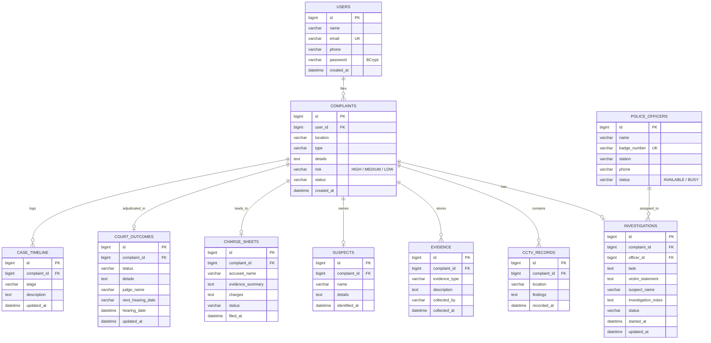

# Sakhi Suraksha AI – Women Safety Complaint & Investigation Management System
> **"Every Woman Safe. Every Journey Protected."**

[](https://www.oracle.com/java/)
[](https://spring.io/projects/spring-boot)
[](https://spring.io/projects/spring-security)
[](https://www.mysql.com/)
[]()
[](https://maven.apache.org/)

---

## 📌 1. Project Overview & Objective

**Sakhi Suraksha AI** is a production-ready enterprise **Java Full Stack Women Safety Complaint and Investigation Management System** engineered for end-to-end transparent lifecycle tracking of women safety incidents. 

The application is tailored specifically for **B.Tech Final-Year Project Demonstration and Viva Voce**, featuring:
- **100% Java Full Stack Architecture** (Zero Python, Zero Flask, Zero SQLite, Zero React/Node).
- Pure **HTML5, CSS3, and Vanilla JavaScript** frontend with Indian National Tricolour styling.
- **Rule-based NLP Risk Assessment Engine** classifying complaints into `HIGH`, `MEDIUM`, or `LOW` priority.
- Relational investigation management workflow: Police Officer Assignment, Confidential Victim Statement Recording (CrPC 161/164), CCTV Surveillance Evidence, Chain-of-Custody Evidence Locker, Suspect Profiling, Formal Charge Sheet Filing (BNS / IPC), and Fast-Track Court Proceedings.
- **Single Source of Truth**: All data persists in **MySQL 8.x** relational tables with foreign keys and cascade integrity (no client-side fake IDs or volatile browser data).

---

## 🔄 2. Complete Case Lifecycle Workflow

```
USER
  │
  ▼
REGISTRATION (BCrypt Hashed)
  │
  ▼
LOGIN (Session Authentication)
  │
  ▼
COMPLAINT SUBMISSION
  │
  ▼
AI RISK ASSESSMENT (HIGH / MEDIUM / LOW Keyword Analysis)
  │
  ▼
UNIQUE COMPLAINT ID GENERATED (#1, #2, ...)
  │
  ▼
POLICE OFFICER ASSIGNMENT (Status -> POLICE ASSIGNED, Officer -> BUSY)
  │
  ▼
INVESTIGATION STARTED (Field visits, site inspection)
  │
  ▼
VICTIM STATEMENT RECORDED (CrPC 161/164 statements)
  │
  ▼
CCTV FOOTAGE CHECK (Location cameras, timestamped evidence)
  │
  ▼
EVIDENCE COLLECTED (Physical, digital, CDR, forensics)
  │
  ▼
SUSPECT IDENTIFIED (Profiling, alibi verification)
  │
  ▼
CHARGE SHEET PREPARED (Formal filing under Bharatiya Nyaya Sanhita)
  │
  ▼
COURT PROCEEDINGS (Fast-Track Mahila Court hearing & trial)
  │
  ▼
CASE CLOSED (Conviction / Disposal & Archival)
```

---

## 🛠️ 3. Technology Stack

| Layer | Technologies Used |
|---|---|
| **Frontend** | HTML5, CSS3, Vanilla JavaScript (ES6+), Fetch API, Responsive Design |
| **Backend Framework** | Java 17+, Spring Boot 3.3.4, Spring Web MVC |
| **ORM & Persistence** | Spring Data JPA, Hibernate ORM, Jakarta Persistence API |
| **Security** | Spring Security 6, `BCryptPasswordEncoder` (10 rounds salting), CORS filter |
| **Relational Database** | MySQL 8.x (`sakhi_suraksha` database) |
| **Build Tool** | Apache Maven 3.9.x |
| **Testing** | JUnit 5 (Jupiter), Spring Test MockMvc, H2 In-Memory DB (for unit/integration testing) |

---

## 🗄️ 4. MySQL Database Schema (10 Entities)

The system automatically provisions and manages 10 relational tables in MySQL (`sakhi_suraksha`):



---

## 🤖 5. AI / NLP Risk Assessment Logic

Implemented in [`RiskAssessmentService.java`](src/main/java/com/sakhi/suraksha/service/RiskAssessmentService.java):

```java
// Rule-based Keyword Evaluation
HIGH Keywords:
  danger, attack, assault, stalk, kidnap, weapon, emergency, kill, acid, rape, murder, molest, urgent

MEDIUM Keywords:
  follow, threaten, harass, suspicious, abuse, blackmail, chase, eve-teasing, lewd, unsafe, scared

LOW Keywords:
  argument, stare, dispute, noise, verbal, other (default fallback)
```

**Evaluation Algorithm:**
1. Text input (`type` + `details`) is normalized to lowercase.
2. Checks against `HIGH` keywords list first. If any match is found, immediately returns `"HIGH"`.
3. If no high risk keyword matched, checks against `MEDIUM` keywords list. If matched, returns `"MEDIUM"`.
4. Otherwise, returns `"LOW"`.

---

## 📡 6. REST API Reference (11 Standard Endpoints)

| # | HTTP Method | Endpoint | Description | Request Body |
|---|---|---|---|---|
| 1 | `POST` | `/api/register` | Register new citizen | `{ name, email, phone, password }` |
| 2 | `POST` | `/api/login` | Authenticate citizen/officer | `{ email, password }` |
| 3 | `POST` | `/api/complaints` | File safety complaint + AI risk score | `{ userId, location, type, details }` |
| 4 | `GET` | `/api/complaints/{id}` | Track complete case dossier & timeline | None (Path Variable `{id}`) |
| 5 | `GET` | `/api/police/officers` | Fetch all police officers | None |
| 6 | `POST` | `/api/investigation/assign` | Assign on-duty police officer | `{ complaintId, officerId, task }` |
| 7 | `POST` | `/api/investigation/update` | Record victim statement & notes | `{ complaintId, victimStatement, suspectName, notes, status }` |
| 8 | `POST` | `/api/cctv` | Record surveillance camera findings | `{ complaintId, location, findings }` |
| 9 | `POST` | `/api/evidence` | Deposit physical/digital evidence | `{ complaintId, evidenceType, description, collectedBy }` |
| 10 | `POST` | `/api/suspect` | Record identified suspect profile | `{ complaintId, name, details }` |
| 11 | `POST` | `/api/charge-sheet` | File formal charge sheet | `{ complaintId, accusedName, evidenceSummary, charges }` |
| 12 | `POST` | `/api/court` | Record judicial court outcome | `{ complaintId, status, details, judgeName, nextHearingDate }` |
| 13 | `POST` | `/api/sos` | Trigger emergency GPS panic alert | `{ userId, location, latitude, longitude, message }` |

### Sample Track Case Response (`GET /api/complaints/{id}`)
```json
{
  "id": 1,
  "name": "Sunita Sharma",
  "location": "Ameerpet Metro Gate 3",
  "type": "Stalking",
  "details": "Followed by a group of men",
  "risk": "HIGH",
  "status": "COURT PROCEEDINGS",
  "createdAt": "2026-10-07T16:30:00",
  "officer": {
    "name": "Ravi Kumar",
    "badgeNumber": "HYD102",
    "station": "Ameerpet PS",
    "phone": "9876543210"
  },
  "investigation": {
    "status": "COMPLETED",
    "victimStatement": "Statement recorded under CrPC 164",
    "suspectName": "Ramesh Kumar",
    "notes": "Suspect apprehended near bus stop"
  },
  "cctv": [
    {
      "id": 1,
      "location": "Metro Exit 2",
      "findings": "Suspect seen following victim",
      "checkedAt": "2026-10-07T16:32:00"
    }
  ],
  "evidence": [
    {
      "id": 1,
      "evidenceType": "CCTV Footage Video Export",
      "description": "Video export saved with SHA-256 hash",
      "collectedBy": "SI Ravi Kumar"
    }
  ],
  "suspect": {
    "name": "Ramesh Kumar",
    "details": "Identified from metro ticket; 28 years old"
  },
  "chargeSheet": {
    "accusedName": "Ramesh Kumar",
    "evidenceSummary": "CCTV + Eyewitness + Chat logs",
    "charges": "BNS Section 78 (Stalking), Section 79"
  },
  "court": {
    "status": "ACCUSED CONVICTED",
    "details": "Sentenced to 3 years rigorous imprisonment",
    "judgeName": "Hon. Fast Track Mahila Court Judge"
  },
  "timeline": [
    {
      "stage": "COMPLAINT REGISTERED",
      "description": "Complaint filed successfully with AI risk level: HIGH",
      "updatedAt": "2026-10-07T16:30:00"
    },
    {
      "stage": "POLICE OFFICER ASSIGNED",
      "description": "Officer Ravi Kumar (HYD102) assigned to case",
      "updatedAt": "2026-10-07T16:31:00"
    }
  ]
}
```

---

## 🚀 7. How to Setup and Run the Application

### Prerequisites
1. **Java JDK 17, 21, or 25** installed (`java -version`).
2. **MySQL 8.x** installed and running on port `3306`.
3. Portable Maven runner is bundled in the project root: `.\mvn.bat`.

### Step 1: Configure MySQL Password
Open [`src/main/resources/application.properties`](src/main/resources/application.properties) and update line 17 with your local MySQL password:
```properties
spring.datasource.url=jdbc:mysql://localhost:3306/sakhi_suraksha?createDatabaseIfNotExist=true&useSSL=false&serverTimezone=UTC&allowPublicKeyRetrieval=true
spring.datasource.username=root
spring.datasource.password=YOUR_MYSQL_PASSWORD
```
*(Note: MySQL will automatically create the `sakhi_suraksha` database if it doesn't already exist).*

### Step 2: Build and Test
Run the automated test suite:
```powershell
.\mvn.bat test
```
*(All 6 unit and end-to-end integration tests execute against the embedded test configuration).*

### Step 3: Run the Spring Boot Server
```powershell
.\mvn.bat spring-boot:run
```
Or run the packaged standalone JAR:
```powershell
java -jar target\sakhi-suraksha-ai-1.0.0.jar
```

### Step 4: Access the Web UI
Open your web browser and navigate to:
```
http://localhost:8080/
```
The application will launch `women.html` with all interactive forms, sample police officers, and live workflow tracking ready!

---

## 🎓 8. B.Tech Viva Voce Preparation Guide

### Q1: What is the architecture of Sakhi Suraksha AI?
> **Answer:** It follows the classic **Layered Architecture (N-Tier)**:
> 1. **Presentation Layer:** HTML5, CSS3, Vanilla JS communicating asynchronously via standard REST JSON APIs.
> 2. **Controller Layer (`@RestController`):** Handles incoming HTTP requests, validates request DTOs (`@Valid`), and maps responses.
> 3. **Service Layer (`@Service`):** Contains the core business logic, AI keyword risk classification, and transaction management (`@Transactional`).
> 4. **Data Access Layer (`@Repository`):** Spring Data JPA interfaces extending `JpaRepository` executing optimized Hibernate queries.
> 5. **Database Layer:** MySQL 8.x relational database enforcing constraints, foreign keys, and indexes.

### Q2: Why did you eliminate Python / Flask and switch to Java Full Stack?
> **Answer:** 
> - **Enterprise Robustness:** Java with Spring Boot provides strong compile-time type safety, dependency injection, and mature enterprise security.
> - **Relational Data Integrity:** Women safety complaints involve multi-step legal workflows (statements, CCTV, evidence, court orders) requiring strict ACID transactions and relational foreign keys, which Hibernate and MySQL handle natively.
> - **Scalability & Performance:** Java Virtual Machine (JVM) thread pools and HikariCP connection pooling offer superior throughput under high concurrency compared to single-threaded Python WSGI setups.

### Q3: How is password security managed in this application?
> **Answer:** 
> Passwords are never stored as plain text. We utilize Spring Security's **`BCryptPasswordEncoder`**. BCrypt uses a salted cryptographic hash function based on the Blowfish cipher with a configurable cost factor (work factor of 10). It protects against rainbow table attacks and dictionary attacks because every generated hash includes an automatically randomized salt.

### Q4: How does the AI Risk Assessment work?
> **Answer:** 
> The system utilizes a rule-based NLP keyword classification engine in `RiskAssessmentService`. When a complaint is submitted, the incident type and description are converted to lowercase and scanned against hierarchical keyword lexicons. High-threat indicators (`attack`, `stalk`, `weapon`, `kidnap`) trigger an immediate **`HIGH`** priority flag; warning indicators (`follow`, `harass`, `threaten`) yield **`MEDIUM`**; while disputes and minor complaints default to **`LOW`**. This risk classification dictates police dispatch urgency.

### Q5: How is the Case Timeline updated across different steps?
> **Answer:** 
> The `CaseTimeline` entity has a `@ManyToOne` relationship with `Complaint`. Whenever an officer updates any stage of the investigation (e.g., officer assignment, CCTV logging, evidence deposit, charge sheet filing, court outcome), the corresponding service invokes `TimelineService.recordStage()`. This inserts an immutable historical audit entry containing the stage name, description, and timestamp, generating a real-time chronological case dossier for victims and senior police leadership.

### Q6: What is the purpose of DTOs (Data Transfer Objects)?
> **Answer:** 
> DTOs decouple internal JPA entity database representations from external HTTP request/response payloads. This prevents accidental exposure of sensitive entity fields (like password hashes), prevents mass-assignment vulnerabilities, and allows custom input validation using Bean Validation annotations (`@NotBlank`, `@Email`, `@NotNull`).

---

## 👥 Default Demo Credentials
- **Pre-seeded Citizen Account:** `sunita@example.com` / `Password@123`
- **Pre-seeded Police Officers:**
  - `Ravi Kumar` (Badge: `HYD102`, Ameerpet PS)
  - `Priya Sharma` (Badge: `HYD103`, Banjara Hills PS)
  - `Anjali Rao` (Badge: `HYD104`, Cyberabad Women PS)
